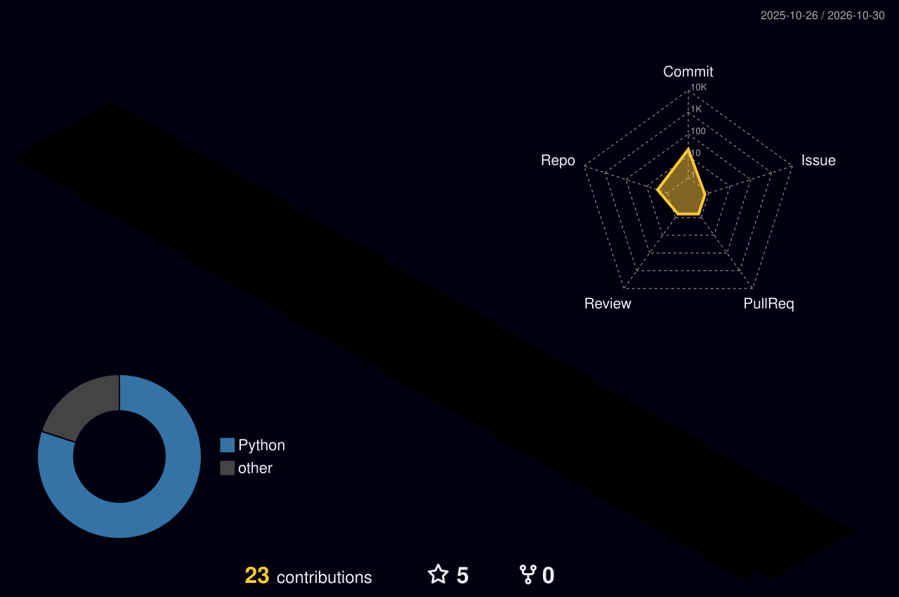

<h3 align="center">Automating power system studies with Python</h3>

- ⚡ **Electrical Engineering**: power system studies with DIgSILENT PowerFactory and ETAP
- 🐍 **Automation**: PowerFactory API, DPL and Python scripting for repeatable studies
- 🗄️ **Data**: SQL databases and Power BI dashboards for simulation results
- 📘 **Building in public**: an open-source Python power flow framework, following *Power System Modelling and Scripting* (F. Milano, Springer)

## 🚀 Featured Projects

| Project | What it does | Stack |
| ------- | ------------ | ----- |
| [CoronaPrediction-HVlines](https://github.com/Ryanqg21/CoronaPrediction-HVlines) | Corona effect prediction on high voltage lines. *(edit with the real description)* | Python |
| [SVM-stability-classification-RES](https://github.com/Ryanqg21/SVM-stability-classification-RES) | Stability classification of power systems with renewables using SVM. *(edit)* | Python, scikit-learn |

## 🛠️ Roadmap: upcoming projects

| Project | What it will cover | Stack | Status |
| ------- | ------------------ | ----- | ------ |
| **PowerFactory + Python setup** | Connecting the PowerFactory API to VS Code with virtual environments (venv) | PowerFactory API, Python, VS Code | 🔜 Next |
| **ETAP + Python setup** | Same workflow for ETAP: virtual environment and scripting from VS Code | ETAP, Python, VS Code | 🔜 Next |
| **PowerFactory automation basics** | Running a load flow, reading busbar loading and losses with DPL and Python | DPL, Python, PowerFactory | 📝 Planned |
| **ETAP automation basics** | Basic studies driven from Python: load flow, loading and losses | ETAP, Python | 📝 Planned |
| **Simulation results to Power BI** | Exporting simulation data to SQL and building dashboards | Python, SQL, Power BI | 📝 Planned |
| **Power system scripting (open source)** | Gauss-Seidel, Newton-Raphson and other iterative methods for power flow, built chapter by chapter | Python, NumPy | 📝 Planned |

## 🧰 Tech Stack

**Power systems:** DIgSILENT PowerFactory · ETAP · DPL

## 📊 3D Contribution Graph

