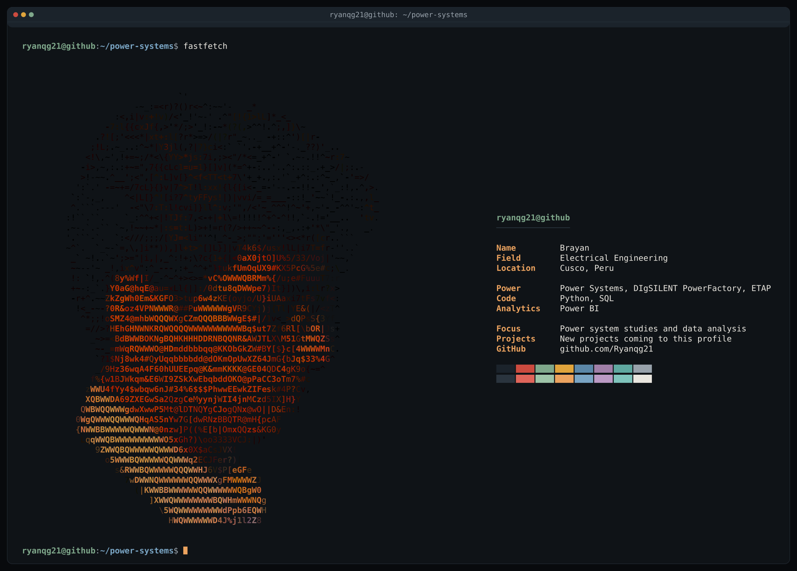

## About me

Electrical engineer focused on power system studies and data analysis.
I use Python and SQL to automate analysis, and Power BI to turn results into dashboards.

## Tools

Power systems: DIgSILENT PowerFactory, ETAP

## Projects

Coming soon. I am preparing my first repositories on:

- Load flow and short-circuit studies
- Python scripts for power system data
- Power BI dashboards

## Contact

- GitHub: [@Ryanqg21](https://github.com/Ryanqg21)